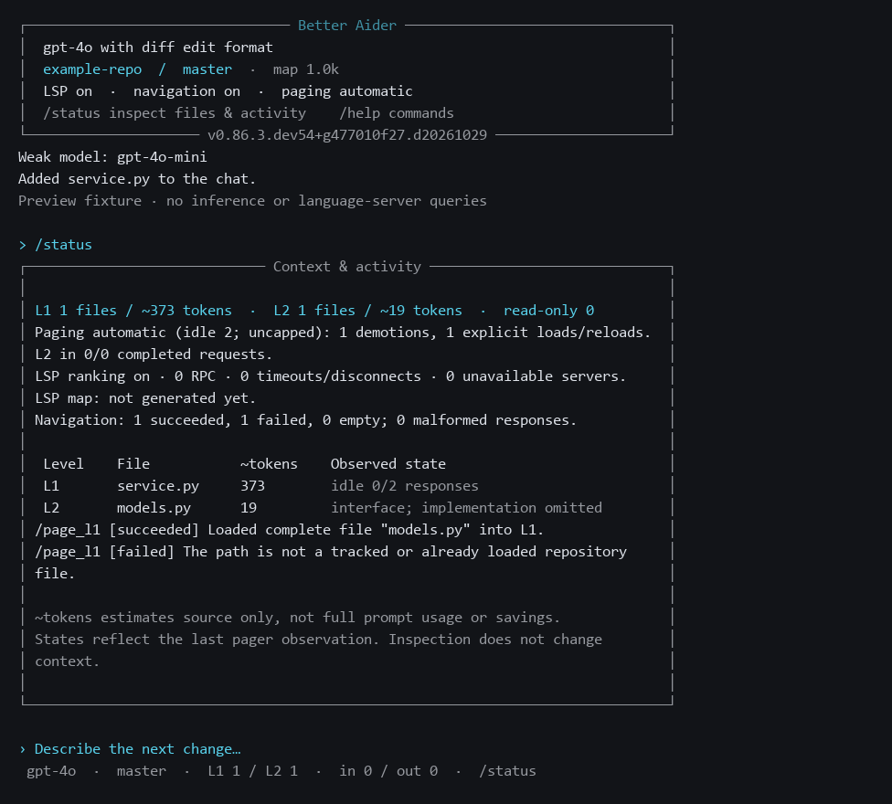

# Compact terminal interface and context inspection

Normal interactive launches now use a compact session header, an input status line,
and assistant response labels. The header identifies the model, repository, branch,
map budget and enabled context features. The input status line shows current L1/L2
file counts and cumulative input/output tokens. Wider terminals also show observed
LSP queries and navigation success/failure counts. Long branch names and the entire
status line are clipped to the available terminal width.

The transcript stays in normal terminal scrollback. Input completion, confirmation
prompts, multiline editing and the existing slash-command workflow remain in place.
The status line is visible while waiting for input; this is not a fullscreen terminal
application.

Use `/status` to inspect:

- Current full source (L1), interface summaries (L2), and read-only files.
- Local source/interface token estimates and the pager's last observed state per file.
- Pending work, failed validation, unchecked edits, idle age and rejected demotions.
- Demotions, explicit loads/reloads, and completed main requests that contained L2.
- Observed bridge RPCs, unavailable servers, timeouts, and the latest semantic map's
  resolution counters, budget exhaustion events and elapsed time.
- Successful, failed and empty navigation actions, malformed protocol responses,
  and the last eight action outcomes with their returned detail.

`/status json` prints the same inspection data as JSON, including configured caps
and the LSP time budget. Neither command makes model requests, queries LSP, builds
the repository map, advances idle age, or changes context membership. Normal status
line redraws also avoid source reads and tokenization.

`/context` retains its existing code-context chat mode. It is not repurposed by this
change. `/tokens` remains available for its existing prompt estimate breakdown.

## Reading the numbers

An enabled feature is configuration, not evidence that it helped. LSP can be enabled
with zero queries or an unavailable server. A demotion can occur after the final
request. The separate **L2 in completed requests** counter reports actual successful
main-model request exposure, rather than treating a locally stored summary as a
token saving. Interrupted or failed requests do not increase that counter.

Source token estimates exclude conversation history, repository maps, instructions,
images and message framing. They are not provider usage, a context-window percentage,
or measured savings. File protection labels describe the pager's last observation;
inspection does not refresh its policy state. Session input/output counters retain
Aider's existing accounting. Pager/navigation counters belong to the current coder;
RPC counters belong to its current bridge, and map counters describe the latest map.
Changing chat modes or models can construct new instances of these objects.

## Compatibility

```powershell
# Original layout
python -m aider --terminal-ui classic --model chatgpt/gpt-6.1-sol

# Plain output
python -m aider --no-pretty --model chatgpt/gpt-6.1-sol
```

`NO_COLOR`, dumb terminals and redirected output retain the plain presentation.
The inspector works in either layout and in plain output. Terminal colors use the
terminal palette and default background; existing user color overrides remain
available. No new runtime dependency is required.

## Preview and verification



The [SVG](previews/terminal-ui.svg) and [HTML](previews/terminal-ui.html) previews
are generated by the real renderers using a disposable repository. The fixture
performs one load, one demotion and one failed navigation action. It makes no model
or language-server queries; its counters are not production benchmark results.

```powershell
.venv/Scripts/python.exe scripts/preview_terminal.py
.venv/Scripts/python.exe -m pytest tests/basic/test_terminal_ui.py tests/basic/test_agent_nav.py -q
```

The preview always exports SVG and HTML. PNG export additionally uses the Windows
Consolas font when available. Tests cover read-only inspection, request-exposure
accounting, JSON export, navigation outcome classification, real input-widget
integration, narrow terminals, literal branch names and classic/plain fallback.

Release verification: the CLI, command, Coder, navigation, pager, LSP, benchmark and
UI groups passed **388 tests and 29 subtests**, with two skips. The previously
recorded headless `test_color_initialization` failure was reproduced separately
and excluded from that release check. Static analysis and Git whitespace checks
passed. Frozen baseline and combined-result fingerprints remained unchanged.

Design references: [Pi's terminal workflow](https://github.com/earendil-works/pi/blob/main/packages/coding-agent/docs/usage.md),
[Codex's terminal styling guidance](https://github.com/openai/codex/blob/main/codex-rs/tui/styles.md),
and [Claude Code's status-line documentation](https://code.claude.com/docs/en/statusline).
The implementation uses the Rich and prompt-toolkit libraries already in this fork.
